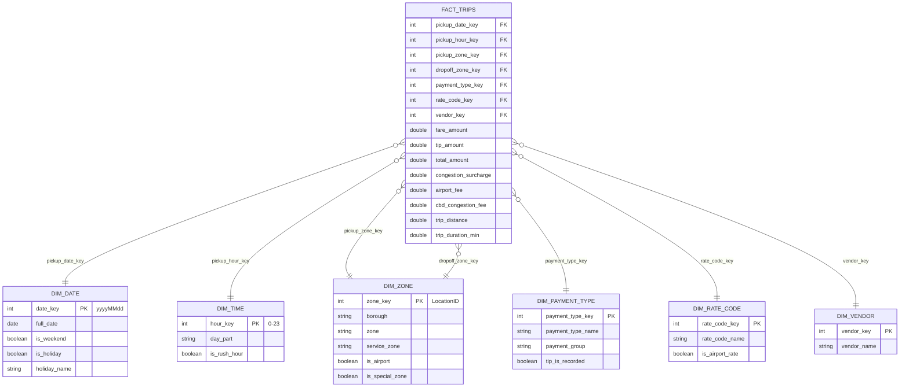
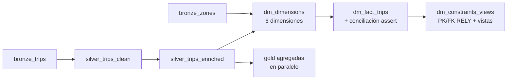

# Data mart dimensional — NYC Taxi (Finanzas TLC)

Data mart en **modelo estrella** sobre la capa Gold de un lakehouse en **Databricks + Unity Catalog**, construido a partir de la capa silver del pipeline NYC Yellow Taxi (ene-2023 → mar-2026, **123,9 millones de viajes**). Responde las preguntas del área de Finanzas de la TLC —ingresos, propinas y recargos por fecha, hora, zona, forma de pago, tarifa y proveedor— sin crear una tabla nueva por cada pregunta y sin darle acceso a silver.

> Curso de Big Data — Maestría en Ciencia de Datos, Universidad Pontificia Bolivariana.
> Autor: **Sebastián Muñoz Palacio**

**Stack:** Databricks (serverless, Photon) · Unity Catalog · Delta Lake · PySpark · Spark SQL · liquid clustering

---

## Resultados principales

| Verificación | Resultado |
|---|---|
| Viajes en la tabla de hechos = viajes en silver | ✅ 123.902.193 = 123.902.193 |
| `SUM(total_amount)` hechos = silver | ✅ USD 3.347.426.474,94 en ambas |
| Llaves huérfanas (7 FK) | ✅ 0 |
| Llaves duplicadas o nulas (6 dimensiones) | ✅ 0 |
| Constraints registradas en Unity Catalog | ✅ 6 `PRIMARY KEY ... RELY` y 7 `FOREIGN KEY` |
| Prueba de permisos con el compañero | ✅ Lee las 2 vistas; `INSUFFICIENT_PERMISSIONS` en `fact_trips` y silver |
| Misma consulta: silver vs. estrella (top 20 pares origen → destino) | ✅ Mismo resultado; estrella **1,67 s** vs. silver **2,46 s** |

---

## Modelo estrella

**Grano:** cada fila de `gold_taxi_dm_fact_trips` es **un viaje** que pasó las reglas de calidad de silver.

| Tabla | Filas | Fuente |
|---|---:|---|
| `gold_taxi_dm_fact_trips` | 123.902.193 | `silver_yellow_trips_enriched` |
| `gold_taxi_dm_dim_date` | 1.186 | Generada con `sequence` + `explode` (2023-01-01 → 2026-03-31), 36 festivos federales |
| `gold_taxi_dm_dim_time` | 24 | Generada (una fila por hora) |
| `gold_taxi_dm_dim_zone` | 266 | `bronze_taxi_zones` + miembro `-1` |
| `gold_taxi_dm_dim_payment_type` | 8 | Data dictionary TLC (0–6) + `-1` |
| `gold_taxi_dm_dim_rate_code` | 7 | Data dictionary TLC (1–6) + `-1` |
| `gold_taxi_dm_dim_vendor` | 5 | Data dictionary TLC (1, 2, 6, 7) + `-1` |
| `gold_taxi_dm_v_revenue_mensual` | vista | Revenue, propinas y recargos por mes y borough |
| `gold_taxi_dm_v_propinas_tarjeta` | vista | Propinas con tarjeta por borough, franja y fin de semana |

---

## Decisiones de diseño

| Decisión | Por qué |
|---|---|
| **Grano = un viaje** | Desde el viaje se puede agregar a cualquier nivel; un grano agregado (zona × día) perdería destino, hora, forma de pago y tarifa. |
| **Ratios fuera de la tabla de hechos** (`tip_rate`, `avg_speed_mph`) | No son aditivos: se recalculan como `SUM(tip) / SUM(fare)`, no como promedio de ratios. |
| **Miembro `-1` "Desconocido / No aplica"** en cada dimensión | Flex Fare llega sin `RatecodeID`; con `-1` ningún `JOIN` pierde viajes y la FK siempre existe. |
| **`dim_zone` role-playing** | Una sola tabla física referenciada dos veces (pickup y dropoff). |
| **Festivos calculados por regla** (5 U.S.C. § 6103, día observado según OPM) | Funcionan para cualquier año cargado; un festivo en sábado se marca el viernes. |
| **`tip_is_recorded` en `dim_payment_type`** | La regla "solo la tarjeta registra propina" vive en un solo lugar. |
| **Medidas faltantes en `NULL`, no en `0`** | `NULL` = no informado / no aplica. Con `0`, `AVG(congestion_surcharge)` cae de 2,37 a 2,06 por los 16,1 M viajes Flex Fare sin dato. |
| **Conciliación con `assert`** | En un workflow a las 3 a. m. un número impreso no detiene nada; un error sí. |
| **`PRIMARY KEY ... RELY`** | Permite al optimizador pre-agregar y eliminar joins; se declara después de que la conciliación prueba unicidad. |
| **Vistas solo con medidas aditivas** | Finanzas puede re-agregarlas sin promediar promedios. |
| **Liquid clustering `(pickup_date_key, pickup_zone_key)`** | Fecha y zona de origen son los filtros más usados; sin particiones pequeñas ni `ZORDER` no incremental. |

---

## Hallazgos de negocio (Parte 4)

1. **Aeropuertos:** son el 6,5 % de los viajes con pickup pero el **16,9 % del revenue**; sumando los que terminan en aeropuerto, el **21,6 %**. La participación bajó de 22–27 % (2023) a 15–17 % (2026).
2. **Festivos:** el ticket hacia aeropuertos es **USD 71,74** en festivos vs. **USD 73,34** en días normales (−2,2 %), en los tres aeropuertos.
3. **Tarifa JFK:** el **96,1 %** de los viajes con `RatecodeID = 2` empieza o termina en JFK. El 3,9 % restante se explica por zonas de Queens vecinas a JFK, ubicación desconocida (264/265) y errores de digitación del conductor.
4. **Propinas:** la mayor propina promedio es en la **madrugada entre semana (USD 4,42)**; la mayor tasa, en la **noche entre semana (23,7 %)**.
5. **Formas de pago:** tarjeta 74,3 %, efectivo 12,9 %, **Flex Fare 12,4 %**. Flex Fare pasó de ~2 % (2023) a ~30 % (feb-2026), así que la cobertura de propinas registradas cae con el tiempo.
6. **Recargos:** pesan **10,2 % del `total_amount` en Manhattan** (congestión + CBD) y 4,3 % en Queens (`airport_fee`).

---

## Rendimiento (Parte 5)

Top 20 pares origen → destino, sin zonas 264/265, mediana de 3 corridas en serverless:

| Versión | Tiempo | Plan |
|---|---:|---|
| Silver (tabla ancha) | 2,46 s | Sin joins: scan → agregación → top-K |
| Estrella (`fact_trips` + `dim_zone` ×2) | **1,67 s** | 2 × `PhotonBroadcastHashJoin`; la tabla de hechos se **pre-agrega** por llaves `INT` antes del join |

---

## Orquestación (Parte 6)

Si la conciliación falla, la tarea se detiene y las vistas de Finanzas no se actualizan con datos malos.

---

## Estructura del repositorio

| Ruta | Contenido |
|---|---|
| [`config.py`](config.py) | Configuración del pipeline con las constantes `T_DM_*` del mart |
| [`notebooks/05-datamart/`](notebooks/05-datamart/) | Código fuente de los notebooks (formato Databricks `.py`) |
| [`notebooks_html/`](notebooks_html/) | Los mismos notebooks **con sus resultados**. Descárgalos y ábrelos en el navegador |
| [`Evidencias/`](Evidencias/) | Capturas de constraints, permisos, prueba del compañero, plan de ejecución y linaje |

### Notebooks (orden de ejecución)

| # | Notebook | Partes del ejercicio |
|---|---|---|
| 1 | [`01_dm_dimensions`](notebooks/05-datamart/01_dm_dimensions.py) | Parte 0 (diseño) y Parte 1 (6 dimensiones) |
| 2 | [`02_dm_fact_trips`](notebooks/05-datamart/02_dm_fact_trips.py) | Parte 2 (tabla de hechos, nulos y conciliación) |
| 3 | [`03_dm_constraints_views_grants`](notebooks/05-datamart/03_dm_constraints_views_grants.py) | Parte 3 (PK/FK, vistas y permisos) |
| 3b | [`03b_dm_partner_test`](notebooks/05-datamart/03b_dm_partner_test.py) | Prueba de permisos (la corre el compañero) |
| 4 | [`04_dm_business_questions`](notebooks/05-datamart/04_dm_business_questions.py) | Parte 4 (6 preguntas de negocio) |
| 5 | [`05_dm_performance_orchestration`](notebooks/05-datamart/05_dm_performance_orchestration.py) | Parte 5 (rendimiento y diseño físico) y Parte 6 (DAG) |

### Evidencias

| Captura | Qué demuestra |
|---|---|
| [`llaves_catalog.png`](Evidencias/llaves_catalog.png) | 7 FK registradas en `fact_trips` y columnas de clustering |
| [`show_grants.png`](Evidencias/show_grants.png) | El compañero solo tiene `USE SCHEMA` y `SELECT` sobre las vistas |
| [`companero_vista_revenue.png`](Evidencias/companero_vista_revenue.png) | El compañero lee `v_revenue_mensual` |
| [`companero_vista_propinas.png`](Evidencias/companero_vista_propinas.png) | El compañero lee `v_propinas_tarjeta` |
| [`companero_error_fact.png`](Evidencias/companero_error_fact.png) | `INSUFFICIENT_PERMISSIONS` en `fact_trips` |
| [`companero_error_silver.png`](Evidencias/companero_error_silver.png) | `INSUFFICIENT_PERMISSIONS` en silver |
| [`broadcast_hash_join.png`](Evidencias/broadcast_hash_join.png) | 2 × `PhotonBroadcastHashJoin` en el plan de la estrella |
| [`lineage.png`](Evidencias/lineage.png) | Linaje silver → `fact_trips` → vistas en Catalog Explorer |

---

## Cómo reproducirlo

1. Tener corridas las capas bronze y silver del módulo `06-end-to-end-nyc-taxi` en tu schema de Unity Catalog.
2. En `00-setup/config`, ajustar `CATALOG` y `SCHEMA` y agregar las constantes `T_DM_*` (ver [`config.py`](config.py)).
3. Importar la carpeta `05-datamart` al lado de `00-setup` y correr los notebooks en orden: 01 → 02 → 03 → 04 → 05.
4. Para los permisos, escribir el correo del compañero en el widget `companero` del notebook 03; él corre `03b` (o las consultas en SQL Editor) con tu schema.

Fuentes: [TLC Trip Record Data](https://www.nyc.gov/site/tlc/about/tlc-trip-record-data.page) · [Data Dictionary – Yellow Taxi](https://www.nyc.gov/assets/tlc/downloads/pdf/data_dictionary_trip_records_yellow.pdf) · [OPM Federal Holidays](https://www.opm.gov/policy-data-oversight/pay-leave/federal-holidays/)
